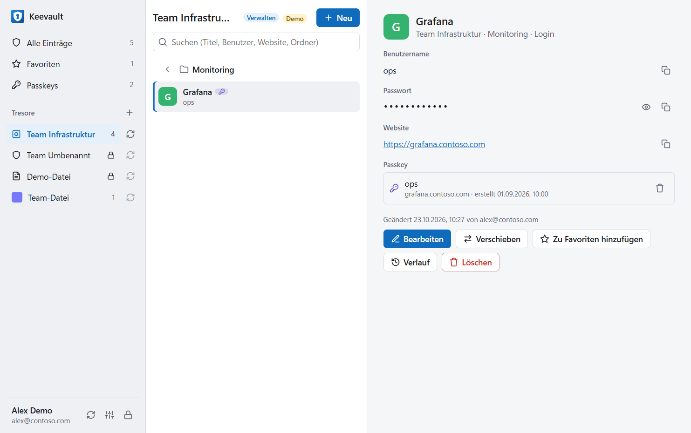
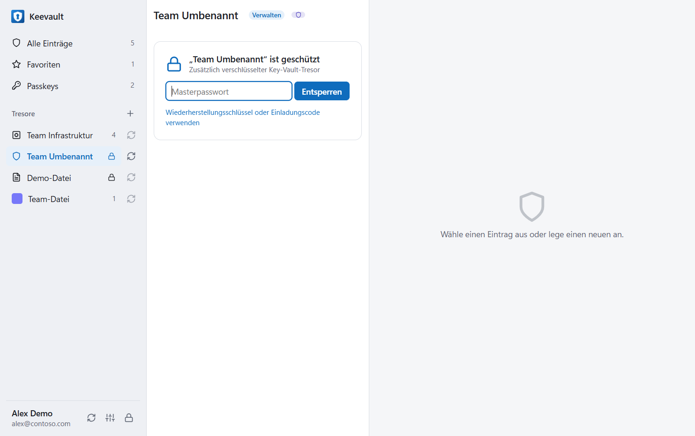
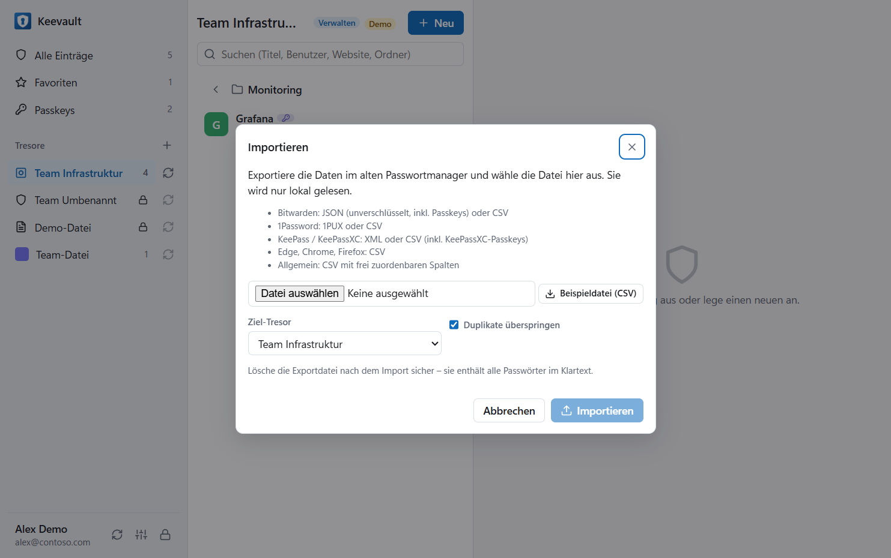
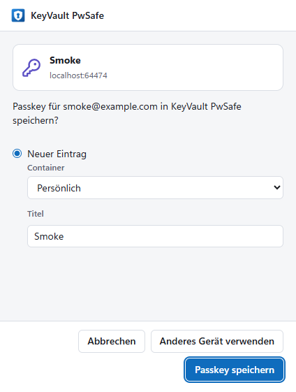

# Keevault

Passwort- und Passkey-Tresor mit einer Desktop-App (Windows, auch macOS/Linux) und einer Browser-Erweiterung
für Edge und Chrome – ähnlich wie 1Password oder Bitwarden, aber ohne eigenen Server. Die Daten liegen wahlweise

- in **Azure Key Vault** – Anmeldung über **Microsoft Entra ID**, Teilen und Protokollierung über Azure RBAC, oder
- in einer **lokalen, verschlüsselten Datei** wie bei KeePass – abgesichert mit **Passkey** und/oder
  **Masterpasswort**, auf Wunsch auf einem Netzlaufwerk für mehrere Benutzer mit je eigenem Passkey.

Oberfläche auf Deutsch oder Englisch.



## Funktionen

- **Container** sind Azure Key Vaults (z. B. „Team Ops“, „Notfall“) oder `.kvpws`-Dateien (z. B. „Persönlich“).
  Key Vaults mit dem Tag `kvpwsafe=container` werden nach der Anmeldung automatisch gefunden, andere per Adresse
  oder Einladungslink (`kvpwsafe://add?…`) hinzugefügt.
- **Teilen**: Key-Vault-Container über Azure-Rollen (*Lesen*, *Bearbeiten*, *Verwalten*) mit Personen- und
  Gruppensuche; Datei-Container über **Einladungscodes** – jede eingeladene Person registriert danach ihren
  eigenen Passkey.
- **Zusätzlicher Schutz** für Key-Vault-Container: Einträge (auch Titel und Websites) werden vor dem Speichern
  verschlüsselt und mit Masterpasswort und/oder Passkey entsperrt – dann kann sie auch kein Azure-Administrator
  lesen. Datei-Container sind immer so geschützt. Dazu gibt es einen Wiederherstellungsschlüssel.
- **Passkeys auf Websites**: Die Erweiterung ist ein Passkey-Anbieter. Registriert eine Website einen Passkey,
  landet der Schlüssel im gewählten Container und steht allen Mitgliedern zur Verfügung. Anmelden geht über einen
  Dialog oder direkt im Auswahlmenü des Benutzerfelds (Conditional UI). „Anderes Gerät verwenden“ führt weiter zu
  Windows Hello oder zum Sicherheitsschlüssel.
- **Windows-Passkey-Anbieter** (wie 1Password): Keevault erscheint im Windows-Passkey-Dialog und
  funktioniert damit auch in anderen Browsern und Apps. Jede Anmeldung bestätigst du in der Desktop-App.
- **Ausfüllen** über das Auswahlmenü in Anmeldefeldern, das Popup oder `Strg+Umschalt+L`; nach dem Anmelden
  bietet die Erweiterung an, neue oder geänderte Logins zu speichern. Datei-Container stellt die Desktop-App der
  Erweiterung bereit (wie KeePassXC-Browser).
- **Einträge**: Logins (Benutzername, Passwort, mehrere Websites, TOTP-Einmalcodes, Zusatzfelder, Notizen,
  Ordner, Favoriten) und sichere Notizen, Passwortgenerator, **Verlauf** mit „geändert von“, **Papierkorb**,
  Konfliktprüfung bei gleichzeitigem Bearbeiten.
- **Abtippen (Auto-Type)**: Eintrag in der App auswählen, ins Zielfeld klicken, `Strg+Umschalt+U` (Benutzername),
  `P` (Passwort) oder `O` (Einmalcode) – überall in Windows, solange die App entsperrt ist; ohne Zwischenablage,
  funktioniert auch dort, wo Einfügen gesperrt ist. Tasten in den Einstellungen umstellbar (Strg+Alt oder aus).
- **Infobereich**: Fenster schließen minimiert neben die Uhr, Passkeys über Windows und Browser laufen weiter.
- **App-PIN** (Einstellungen) vor dem Entsperren; per `requirePin` in `kvpwsafe.config.json` vorschreibbar.
- **Anmeldung im Windows-Dialog** (WAM, wie PowerShell/Azure CLI) statt im Browser; abschaltbar.
- **Import** mit Vorschau, Spaltenzuordnung und Duplikatprüfung aus Bitwarden (JSON inkl. Passkeys, CSV),
  1Password (1PUX, CSV), KeePass/KeePassXC (XML inkl. KeePassXC-Passkeys, CSV), Edge/Chrome/Firefox (CSV) und
  beliebigen CSV-Dateien – siehe [Beispieldatei](samples/kvpwsafe-import-sample.csv). **Kein Export**: Einträge verlassen die App nie im Klartext als Datei; Sicherungen laufen über den Key Vault (Soft Delete, Löschschutz) oder als **verschlüsseltes Backup** mit Einmal-Passwort – nur für Owner der Subscription.
- **Automatisches Sperren** bei Inaktivität und Bildschirmsperre; kopierte Passwörter verschwinden nach 30 s aus
  der Zwischenablage. Verteilung per Intune/GPO (Richtlinien für die Erweiterung, `kvpwsafe.config.json`).

| Geschützter Container | Import | Passkey speichern |
| --- | --- | --- |
|  |  |  |

## So funktioniert es

```
Desktop-App ─┬─ Entra-ID-Token ──▶ Key Vault „Team Ops“      Azure-Rollen: Gruppe Ops
             │                    Key Vault „Notfall“        zusätzlich verschlüsselt (Masterpasswort/Passkeys)
             └─ Dateisystem ─────▶ team.kvpws (Netzlaufwerk)  Passkeys von Alex und Kim, Wiederherstellungsschlüssel
                    ▲
Erweiterung ────────┴─ Native Messaging (Datei-Container)     Key Vault direkt mit eigenem Entra-Token
```

Ein Eintrag ist ein Secret im Key Vault bzw. ein Datensatz in der Datei. Verschlüsselte Container nutzen einen
zufälligen Container-Schlüssel (AES-256-GCM), der für jede Entsperrmethode einzeln verpackt ist: Masterpasswort
(PBKDF2), Passkey (WebAuthn-PRF), Wiederherstellungsschlüssel und Einladungen. Details in
[docs/ARCHITEKTUR.md](docs/ARCHITEKTUR.md), Sicherheitsmodell in [docs/SICHERHEIT.md](docs/SICHERHEIT.md).

## Installation (install.exe)

`Keevault-Setup-<Version>.exe` aus den [Releases](https://github.com/dominguez-posh/keyvault-pwsafe-releases/releases)
installiert **pro Benutzer, ohne Administratorrechte** (nach `%LOCALAPPDATA%\Programs`, mit Uninstaller):

- Desktop-App mit Startmenü- und Desktop-Verknüpfung; Browser-Anbindung und Passkey-Anbieter sind eingeschaltet.
- Beim ersten Start installiert und registriert die App den **Windows-Passkey-Anbieter** für den Benutzer und zeigt
  einmal, wo er in Windows einzuschalten ist (das verlangt Windows selbst).
- Zwei Dinge gehen nur gerätweit und brauchen einmal Admin oder die IT: das Vertrauen ins (selbstsignierte)
  Zertifikat des Passkey-Anbieters und die Browser-Richtlinie, die die **Erweiterung** in Edge/Chrome installiert.
  Fehlt etwas, meldet die App das einmal pro Version und bietet **Mit Administratorrechten einrichten** an
  (auch unter Einstellungen → Einrichtung dieses Geräts).

**Für die IT (Intune):** `Keevault-Geraet-Einrichten.ps1` aus dem Release als Plattformskript (als System, 64-Bit)
zuweisen – Zertifikat ist eingebettet. Es vertraut dem Zertifikat und setzt `ExtensionInstallForcelist` für Edge und
Chrome (Quelle: neuestes GitHub-Release, Updates automatisch; wirkt auf verwalteten Geräten). Entfernen:
`-Action Uninstall`. Protokoll: `%ProgramData%\Keevault\setup.log`. Mit einem gekauften Code-Signing-
Zertifikat (`windows/build.ps1 -PfxPath`) entfällt der Zertifikatsteil ganz.

Bauen (lokal, der Schlüssel der Erweiterung bleibt auf dem Rechner): `npm run installer`, mit
`pwsh scripts/release.ps1 -Publish` zusätzlich als GitHub-Release hochladen. Jede Version braucht eine höhere
Nummer in `package.json` und `extension/manifest.json`.

## Lizenz

Ohne Lizenz nimmt ein Tresor bis zu 10 Einträge auf, mit allen Funktionen (Bearbeiten und Löschen gehen immer).
Eine Lizenz gilt dauerhaft für genau einen Tresor und alle, die ihn nutzen – erhältlich auf
<https://keevault.de/lizenz.html>:

1. In der App: Rechtsklick auf den Tresor → **Lizenz** → Anfragecode (`KVP-…`) kopieren.
2. Auf der Website anfragen; nach Zahlungseingang kommt der Lizenzschlüssel (`KVPL-…`) per E-Mail.
3. Schlüssel im selben Dialog eintragen → **Aktivieren**. Er wird im Tresor gespeichert (Key Vault: Secret
   `pws-container`, Datei: in der Datei) und gilt damit für alle, die den Tresor nutzen.

Der Anfragecode ist aus dem Key-Vault-Namen (bzw. der Datei-ID) abgeleitet; Key-Vault-Namen sind weltweit eindeutig,
ein Schlüssel passt also nur zu einem Tresor. Schlüssel sind mit Ed25519 signiert, die App enthält nur die
öffentlichen Schlüssel – Lizenzen lassen sich mit dem Quellcode nicht selbst erzeugen. Die Prüfung findet offline in
der App statt; Keevault meldet nichts an den Anbieter.

## Einrichtung

### Nur lokale Dateien (ohne Azure)

```powershell
npm install
npm start
```

Beim ersten Start **Lokale Datei (wie KeePass)** wählen, Namen, deine E-Mail-Adresse und den Passkey festlegen
(Windows Hello auf diesem Gerät oder Sicherheitsschlüssel/Smartphone). Du wirst Admin der Datei. Die Datei öffnet
sich **nur mit Passkey** – es gibt kein Masterpasswort und keinen Wiederherstellungscode; richte daher einen zweiten
Passkey oder einen zweiten Admin ein.

Für mehrere Benutzer die Datei auf ein gemeinsames Laufwerk legen und unter **Benutzer und Freigabe** die Freigabe
aktivieren. Die andere Person öffnet die Datei, gibt unter **Zugriff anfordern** ihre E-Mail-Adresse ein und
registriert ihren Passkey; die App zeigt ihr einen Sicherheitscode. Du vergleichst den Code (z. B. am Telefon) und
gibst sie mit einer Rolle frei: **Admin** (Benutzer verwalten), **Bearbeiten** oder **Lesen**. Entfernst du jemanden,
bekommt die Datei einen neuen Schlüssel.

- Wer eine Datei mit einem Sicherheitsschlüssel öffnet, kann sie danach **mit Windows Hello merken** (PIN,
  Gesicht, Fingerabdruck) – das ist ein zusätzlicher Passkey, der an das Gerät gebunden ist.
- **Änderungsprotokoll** (Uhr-Symbol): jede Änderung mit Person, Zeit und geänderten Feldern, auch je Eintrag.
  Jede Änderung ist von ihrer Autorin oder ihrem Autor signiert; Änderungen ohne gültige Signatur oder ohne
  Schreibrecht werden ignoriert und rot markiert.
- **Ordner und Unterordner** (Ordner-Symbol, z. B. `Kunden/Contoso`) gibt es in Datei- und Key-Vault-Containern.
- Ältere Dateien (Masterpasswort, Wiederherstellungsschlüssel, Einladungscodes) lassen sich weiter öffnen und über
  das Schlüssel-Symbol **in das abgesicherte Format umwandeln**.

### Mit Azure Key Vault

Schritt-für-Schritt-Anleitung inkl. Berechtigungen: [docs/ANLEITUNG-Tresor-in-Azure.md](docs/ANLEITUNG-Tresor-in-Azure.md).

**Desktop-App ohne Einrichtung:** Beim ersten Start **Azure Key Vault (Microsoft Entra ID)** wählen und mit dem
Arbeitskonto anmelden – IDs braucht es nicht. Die App meldet sich mit dem öffentlichen Azure-CLI-Client von
Microsoft an (wie die Azure-SDKs ohne eigene App-Registrierung), findet Container (Tag `kvpwsafe=container`)
automatisch und listet unter **+ → Vorhandenen Key Vault hinzufügen** alle Key Vaults, die du in Azure sehen
darfst. Das Verzeichnis (Tenant) wechselst du in den Einstellungen. Blockiert eure Organisation den Azure-CLI-Client
per bedingtem Zugriff oder soll die Anmeldung eine eigene Identität haben, trägst du dort unter **Eigene
App-Registrierung** Tenant-ID und Client-ID ein. Die Browser-Erweiterung braucht immer die eigene
App-Registrierung (Redirect-URI der Erweiterung).

**Key Vaults bei Kunden (Gastkonten):** Die Desktop-App erkennt den Tenant jedes Key Vaults selbst und holt das
Token dort – Vaults aus mehreren Tenants sind gleichzeitig nutzbar. Voraussetzung ist ein Gastkonto (B2B) im
Kunden-Tenant mit der Rolle „Key Vault Secrets User“/„Officer“ (und „Leser“ für die automatische Suche).
Azure Lighthouse reicht nicht: Lighthouse vergibt keine Rollen mit Datenzugriff, die Vaults sind dann sichtbar, aber
gesperrt. Verlangt der Kunden-Tenant eine eigene Anmeldung (MFA), zeigt der Container **Im Tenant des Key Vaults
anmelden**. Mit Besitzer-Rechten (Owner/Benutzerzugriffsadministrator) auf dem Vault gibst du ihn über **Freigeben**
frei – die Suche läuft im Verzeichnis des Kunden, unbekannte E-Mail-Adressen lädst du direkt als Gast ein (dafür
muss dein Konto dort Gäste einladen dürfen).

**Container-Kennzeichnung:** Jeder Key-Vault-Container trägt das Secret `pws-container` (Kennung, Name, Logo).
Die Auswahl „Vorhandenen Key Vault hinzufügen“ zeigt nur Vaults, deren Kennzeichnung du lesen kannst – also
eingerichtete Container mit Datenzugriff. Neue Container legst du in einer Ressourcengruppe an (Besitzer bzw.
Mitwirkender nötig) oder übernimmst einen vorhandenen leeren Key Vault; Subscriptions, die nur über Lighthouse
sichtbar sind, sind dafür gesperrt.

**Eigene App-Registrierung und Container per Skript** – Voraussetzungen: PowerShell 7 mit `Az.Accounts`,
Node.js 22 oder neuer, ein Azure-Abonnement.

```powershell
./infra/Setup-KvPwSafe.ps1 -TenantId contoso.onmicrosoft.com -GrantAdminConsent -ConfigPath ./kvpwsafe.config.json
./infra/New-KvPwSafeContainer.ps1 -Name kv-pws-ops -DisplayName 'Team Ops' -ResourceGroupName rg-kvpwsafe `
    -Owners lead@contoso.com -Editors 'group:Ops-Team' -Readers 'group:Helpdesk'
```

Das erste Skript legt die App-Registrierung an (öffentlicher Client `http://localhost` für die Desktop-App,
SPA-Redirect `https://pbkjijhihclckeeefbepoedgdmajioip.chromiumapp.org/` für die Erweiterung, delegierte
Berechtigungen für Key Vault, Resource Manager und Graph). Das zweite legt einen Container an; das geht auch in
der Desktop-App (**+ → Neuen Key-Vault-Container erstellen**) oder per Bicep (`infra/container.bicep`).

| In der App | Azure-Rolle auf dem Key Vault |
| --- | --- |
| Lesen | Key Vault Secrets User |
| Bearbeiten | Key Vault Secrets Officer |
| Verwalten (freigeben) | Key Vault Secrets Officer + Key Vault Data Access Administrator |
| automatisch auffindbar | zusätzlich Leser (Reader) |

### Desktop-App

```powershell
npm start          # App starten
npm run demo       # Oberfläche mit Beispieldaten ausprobieren, ganz ohne Azure
npm run dist       # Installer und portable EXE nach release/
```

Ohne Angaben meldet sich die App mit dem Azure-CLI-Client an. Eigene Tenant-ID und Client-ID kommen aus den Einstellungen oder aus `kvpwsafe.config.json` (neben der EXE, unter
`%ProgramData%\Keevault\` oder im Projektordner). GitHub Actions baut den Installer für Tags `v*`.

### Browser-Erweiterung

1. `edge://extensions` (bzw. `chrome://extensions`) öffnen, **Entwicklermodus** einschalten,
   **Entpackte Erweiterung laden** und den Ordner `extension` wählen.
2. In den Einstellungen der Erweiterung Sprache, Tenant-ID und Client-ID festlegen und entsperren.
3. Für Datei-Container in der Desktop-App unter **Einstellungen → Datei-Container in der Browser-Erweiterung
   verfügbar machen** einschalten und beim ersten Zugriff der Erweiterung zustimmen.

Im Unternehmen: Installation über den Edge-Add-ons-Store (privat) oder eine selbst gehostete CRX
(`npm run ext:pack`; Store-Versionen haben eine eigene ID → `Setup-KvPwSafe.ps1 -ExtensionId <id>` und in der
Desktop-App unter *Erweiterungs-IDs* eintragen). Einstellungen per Richtlinie unter
`HKLM\SOFTWARE\Policies\Microsoft\Edge\3rdparty\extensions\<id>\policy` (Schema: `extension/managed_schema.json`).

### Windows-Passkey-Anbieter (Windows 11 ab Build 26100.8524 / 26200.8524)

```powershell
./windows/build.ps1                   # baut und signiert das MSIX (.NET SDK 10 nötig; selbstsigniertes Testzertifikat)
./windows/Install-PasskeyProvider.ps1 # vertraut dem Testzertifikat (einmal UAC), installiert und registriert
```

Danach in Windows unter **Einstellungen → Konten → Passkeys → Erweiterte Optionen** „Keevault“
einschalten und in der Desktop-App unter **Einstellungen → Windows-Passkey-Anbieter** den Haken setzen. Fragt eine
Website oder App nach einem Passkey, wählst du im Windows-Dialog „Keevault“; die Desktop-App startet bei
Bedarf, fragt nach dem Container bzw. Passkey und signiert. Für die Verteilung im Unternehmen signierst du das
Paket mit eurem Code-Signing-Zertifikat (`build.ps1 -PfxPath … -Publisher …`).

## Grenzen

- Passkeys mit ES256 (nutzen praktisch alle Websites); keine PRF-/largeBlob-Erweiterungen für Websites. Anfragen
  aus fremden iframes und für Sicherheitsschlüssel gehen an den Browser.
- Passkeys als Entsperrmethode brauchen PRF: FIDO2-Sicherheitsschlüssel, Smartphone, Windows Hello auf aktuellem
  Windows 11. Registriert werden sie je App (Desktop bzw. Erweiterung); in der jeweils anderen App entsperrt man
  einmal mit Masterpasswort, Wiederherstellungsschlüssel oder Einladung und fügt dort einen Passkey hinzu.
  Die Desktop-App unterstützt Passkeys zum Entsperren nur unter Windows.
- Entfernt man eine Person aus einem verschlüsselten Container, kann sie ihn nicht mehr entsperren. Wer den
  Schlüssel vorher ausgelesen hat, kann alte Kopien aber weiter lesen – wichtige Passwörter dann ändern.
- Nur Chromium-Browser (Edge, Chrome). Key Vault erlaubt 25 KB je Eintrag – keine Dateianhänge.
- Gleichzeitiges Arbeiten an einer Datei auf OneDrive kann Konfliktkopien erzeugen; auf Netzlaufwerken werden
  Änderungen je Eintrag zusammengeführt.

## Quellcode prüfen und selbst bauen

Der Quellcode ist offen einsehbar, damit du selbst prüfen kannst, was Keevault mit deinen Passwörtern macht – ohne uns
vertrauen zu müssen. Einstiegspunkte: [Sicherheitsmodell](docs/SICHERHEIT.md), [Architektur](docs/ARCHITEKTUR.md).

**Selbst bauen** (Windows, Node.js 24):

```powershell
npm ci
npm test
npm run dist          # portable Desktop-App in release/
```

**Offiziellen Installer mit dem Quellcode vergleichen:** Der App-Code liegt im Installer unverändert und lesbar in
`app.asar`. Nach der Installation (Version unten rechts in der App):

```powershell
git checkout v<Version>
npx --yes @electron/asar extract "$env:LOCALAPPDATAProgramsKeevault
esourcesapp.asar" "$env:TEMPkeevault-app"
git diff --no-index --stat desktop "$env:TEMPkeevault-appdesktop"
git diff --no-index --stat extensioncore "$env:TEMPkeevault-appextensioncore"
```

Keine Ausgabe heißt: identisch. (`package.json` ergänzt der Build um Installer-Angaben.) Selbst gebaute Versionen
nutzen eine andere Erweiterungs-ID und einen eigenen, nicht vertrauenswürdig signierten Passkey-Anbieter – für den
Alltag ist der offizielle Installer gedacht.

Sicherheitslücken bitte vertraulich melden: [SECURITY.md](SECURITY.md).

## Entwicklung

```powershell
npm test                              # Unit-Tests: Kern, Passkeys gegen @simplewebauthn/server, Verschlüsselung,
                                      # Datei-Container mit zwei Benutzern, Importformate, Übersetzungen, Bridge
npm run check                         # Syntax, Importe, Manifest- und HTML-Verweise
npm run smoke                         # Desktop-App versteckt starten, Demo durchklicken (Passkeys virtuell)
node scripts/extension-smoke.mjs      # Erweiterung headless in Edge/Chrome mit Demo-Daten, Ende-zu-Ende
```

`extension/core/` ist der gemeinsame Kern (Key Vault, Azure, Verschlüsselung, Datei-Container, Passkeys, Import,
Übersetzungen, UI-Bausteine) und wird von der Erweiterung und der Desktop-App ohne Build-Schritt genutzt.
Neue Texte schreibst du auf Deutsch mit `t('…')` und ergänzt die englische Fassung in `extension/core/i18n-en.js`
(`npm test` meldet fehlende Übersetzungen).

Lizenz: [Elastic License 2.0](LICENSE), source-available – Erläuterung auf Deutsch in [LIZENZ.md](LIZENZ.md).
