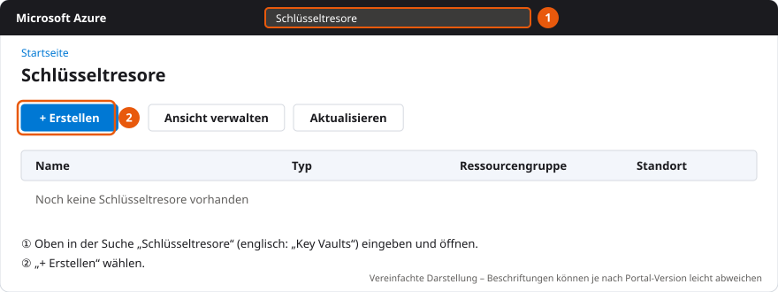
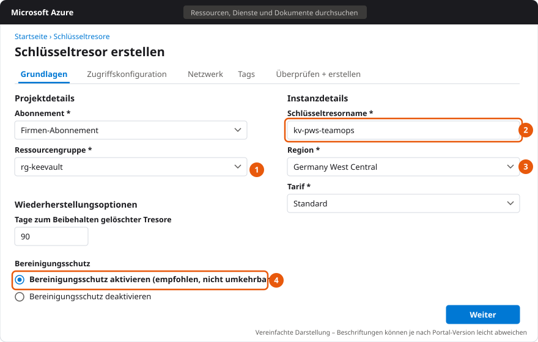
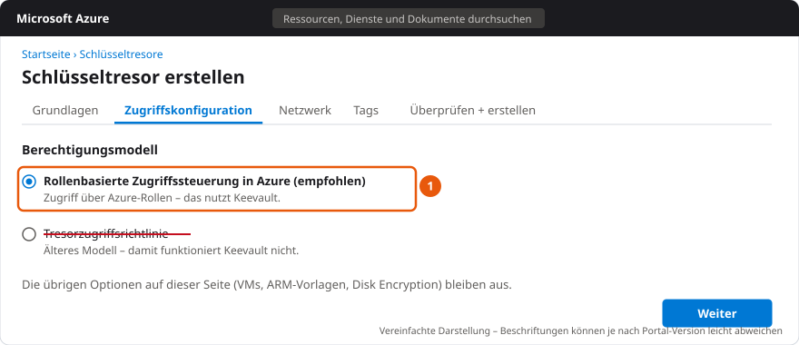
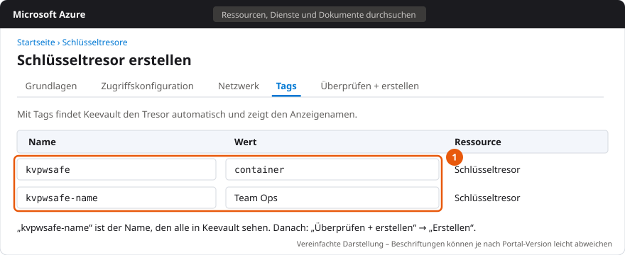
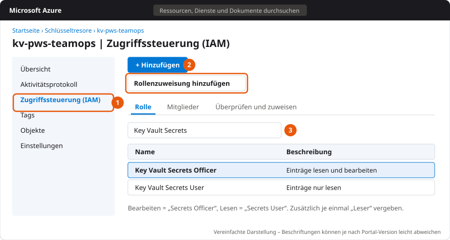
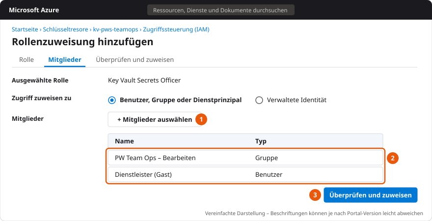
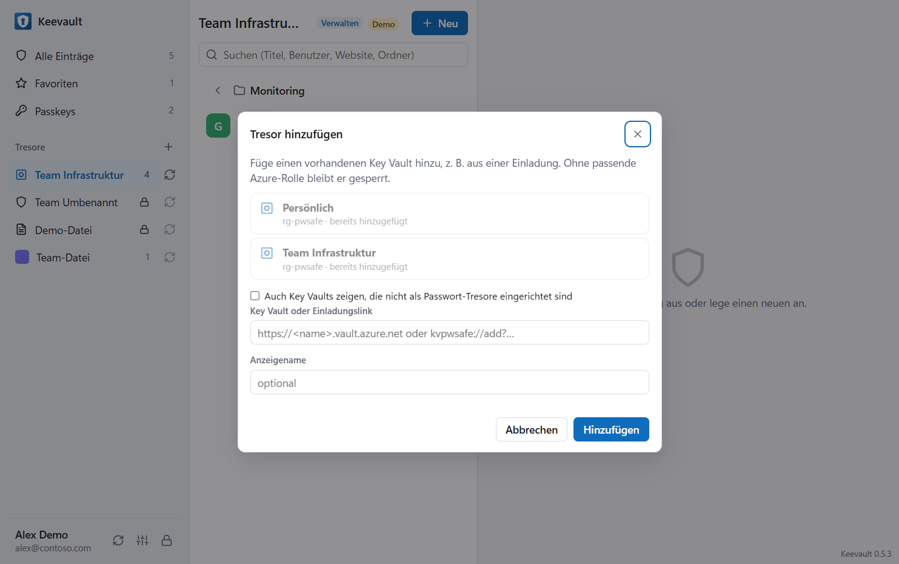

# Einen neuen Tresor in Azure einrichten

Diese Anleitung zeigt, wie du einen Tresor für Keevault in Azure anlegst und wer welche Rechte braucht.
Ein Tresor ist ein Azure Key Vault: Jeder Eintrag ist ein Secret darin, Zugriff und Freigabe laufen über
Azure-Rollen. Die Lizenzierung eines Tresors beschreibt eine eigene Anleitung.

## Inhalt

1. [Vorab: Was du brauchst](#1-vorab-was-du-brauchst)
2. [Weg A: Tresor in der App anlegen (empfohlen)](#2-weg-a-tresor-in-der-app-anlegen-empfohlen)
3. [Weg B: Key Vault in Azure anlegen (One-Klick, Portal oder Terraform)](#3-weg-b-key-vault-in-azure-anlegen-one-klick-portal-oder-terraform)
4. [Berechtigungen](#4-berechtigungen)
5. [Externe Personen und Kunden-Tenants](#5-externe-personen-und-kunden-tenants)
6. [Netzwerk und Firewall](#6-netzwerk-und-firewall)
7. [Sicherung, Wiederherstellung und Protokoll](#7-sicherung-wiederherstellung-und-protokoll)
8. [Prüfen und Fehler beheben](#8-prüfen-und-fehler-beheben)
9. [Checkliste](#9-checkliste)

---

## 1. Vorab: Was du brauchst

- **Ein Azure-Abonnement (Subscription)** und eine **Ressourcengruppe**, in der der Key Vault liegen soll.
- **Rechte auf dieser Ressourcengruppe**, um einen Key Vault anzulegen und Rollen zu vergeben:
  - **Besitzer** (Owner), oder
  - **Mitwirkender** (Contributor) **und** **Benutzerzugriffsadministrator** (User Access Administrator).

  Mitwirkender allein reicht zum Anlegen, aber nicht, um anderen Zugriff zu geben.
- **Keevault** (Desktop-App) auf deinem Rechner, angemeldet mit deinem Arbeitskonto.

> **Wichtig bei Kunden-Subscriptions:** Lege den Tresor immer **im Tenant an, dem die Subscription gehört** – mit
> einem Konto oder Gastkonto aus diesem Tenant. Siehst du die Subscription nur über **Azure Lighthouse**, lässt sich
> dort kein nutzbarer Tresor anlegen: Lighthouse vergibt keine Rollen mit Datenzugriff und lädt keine Gäste ein. Mehr
> dazu in [Abschnitt 5](#5-externe-personen-und-kunden-tenants).

---

## 2. Weg A: Tresor in der App anlegen (empfohlen)

Die App legt den Key Vault mit den richtigen Einstellungen an, kennzeichnet ihn als Tresor und vergibt die Rollen in
einem Schritt.

1. In der Seitenleiste neben **Tresore** auf **+** klicken → **Neuen Key-Vault-Tresor erstellen**.
2. **Anzeigename** eingeben, z. B. „Kunde Contoso“. Daraus schlägt die App einen Key-Vault-Namen vor.
3. **Abonnement** und **Ressourcengruppe** wählen.
   - Abonnements mit dem Zusatz **(Gast)** liegen in einem anderen Tenant, in dem du Gast bist – das funktioniert.
   - Abonnements mit **(nur Lighthouse)** sind gesperrt (siehe oben).
   - Fehlen dir auf der Ressourcengruppe die Rechte zum Anlegen, zeigt die App das sofort an.
4. Unter **Key Vault** wählen:
   - **Neuen Key Vault in der Ressourcengruppe anlegen** – dann den **Key-Vault-Namen** prüfen: 3–24 Zeichen,
     Buchstaben, Ziffern und Bindestriche, beginnt mit einem Buchstaben, **weltweit eindeutig**. Der Name lässt sich
     später nicht ändern (der Anzeigename schon).
   - oder **Vorhandenen leeren Key Vault verwenden** (siehe [Weg B](#3-weg-b-key-vault-in-azure-anlegen-one-klick-portal-oder-terraform)).
5. **Region** wählen (z. B. „Germany West Central“) und **Löschschutz (Purge Protection)** eingeschaltet lassen.
6. Unter **Zugriff** die Personen oder – besser – **Entra-Gruppen** eintragen und je eine Stufe wählen:
   **Lesen**, **Bearbeiten** oder **Verwalten** (Bedeutung siehe [Abschnitt 4](#4-berechtigungen)).
   Eine E-Mail-Adresse, die es im Verzeichnis noch nicht gibt, kannst du direkt **als Gast einladen**.
7. **Erstellen** klicken.

Du selbst bekommst automatisch **Bearbeiten** und **Verwalten**. Neue Rollen brauchen in Azure einige Minuten, bis sie
wirken – sieht der Tresor kurz „Kein Zugriff“ an, nach zwei, drei Minuten auf **Aktualisieren** (Pfeil neben dem
Tresornamen) klicken.

---

## 3. Weg B: Key Vault in Azure anlegen (One-Klick, Portal oder Terraform)

Für Fälle, in denen die IT den Key Vault anlegt. Alle drei Varianten führen zum selben Ergebnis wie Weg A:
RBAC-Key-Vault im Tenant der Subscription, Löschschutz, Tags zum automatischen Finden und Rollen für die gewünschten
Personen und Gruppen.

| Variante | Für wen | Dauer |
| --- | --- | --- |
| [3.1 One-Klick](#31-one-klick-deploy-to-azure) | ein einzelner Tresor, ohne Werkzeuge | 3 Minuten |
| [3.2 Azure-Portal](#32-im-azure-portal-schritt-für-schritt) | wer jeden Schritt selbst sehen will | 10 Minuten |
| [3.3 Terraform](#33-mit-terraform) | mehrere Tresore, Infrastruktur als Code | einmal einrichten |

Voraussetzung in allen Fällen: **Besitzer** (oder Mitwirkender + Benutzerzugriffsadministrator) auf der
Ressourcengruppe, angemeldet **im Tenant der Subscription** – bei Kunden als Gast, nicht über Azure Lighthouse.

### 3.1 One-Klick: Deploy to Azure

[](https://portal.azure.com/#create/Microsoft.Template/uri/https%3A%2F%2Fraw.githubusercontent.com%2Fdominguez-posh%2Fkeyvault-pwsafe-releases%2Fmain%2Finfra%2Fazuredeploy.json)

Der Knopf öffnet im Azure-Portal die Vorlage [`infra/azuredeploy.json`](https://github.com/dominguez-posh/keyvault-pwsafe-releases/blob/main/infra/azuredeploy.json)
(Quelle: [`azuredeploy.bicep`](https://github.com/dominguez-posh/keyvault-pwsafe-releases/blob/main/infra/azuredeploy.bicep)).

1. **Abonnement** und **Ressourcengruppe** wählen (oder neu erstellen), **Region** wie gewünscht.
2. **Vault Name**: weltweit eindeutig, z. B. `kv-pws-teamops`. **Display Name**: der Name in Keevault, z. B. `Team Ops`.
3. **Berechtigte** als Objekt-IDs eintragen, als Liste in eckigen Klammern, z. B. `["1a2b3c4d-…", "5e6f7a8b-…"]`:
   - **Read Principal Ids** – Lesen
   - **Write Principal Ids** – Bearbeiten
   - **Manage Principal Ids** – Verwalten (Bearbeiten + Freigeben)
4. **Überprüfen + erstellen** → **Erstellen**.

Die Objekt-ID steht in **Entra ID → Benutzer** bzw. **Gruppen** → Eintrag öffnen → **Objekt-ID**. Gruppen statt
einzelner Personen sind am einfachsten zu pflegen. Du selbst bekommst automatisch **Verwalten** (**Grant Deployer**
= `true`).

Fertig: Der Tresor erscheint bei allen Berechtigten nach der Anmeldung (oder **Aktualisieren**) in Keevault – die
Vorlage schreibt die Tresor-Kennzeichnung gleich mit. Rollen brauchen in Azure bis zu 10 Minuten.

> **Vorlage nicht ein zweites Mal auf denselben Key Vault anwenden** – oder dabei **Write Marker** auf `false`
> setzen. Sonst überschreibt sie die Tresor-Kennzeichnung, in der Keevault die Lizenz und das Logo speichert.

### 3.2 Im Azure-Portal, Schritt für Schritt

**Schritt 1 – Key Vault anlegen.** Im [Azure-Portal](https://portal.azure.com) oben **Schlüsseltresore** (englisch
*Key Vaults*) suchen und **+ Erstellen** wählen.



**Schritt 2 – Grundlagen.** ① Ressourcengruppe, ② weltweit eindeutiger Name, ③ Region (z. B. Germany West Central),
Tarif **Standard**, 90 Tage Aufbewahrung und ④ **Bereinigungsschutz aktivieren** (Löschschutz – empfohlen, nicht
umkehrbar).



**Schritt 3 – Zugriffskonfiguration.** Berechtigungsmodell **Rollenbasierte Zugriffssteuerung in Azure**.
Mit „Tresorzugriffsrichtlinie“ funktioniert Keevault nicht.



**Schritt 4 – Netzwerk.** **Öffentlicher Zugriff: Alle Netzwerke** – oder ausgewählte Netzwerke, siehe
[Abschnitt 6](#6-netzwerk-und-firewall).

**Schritt 5 – Tags.** `kvpwsafe` = `container` und `kvpwsafe-name` = Anzeigename. Damit findet Keevault den Tresor
selbst. Danach **Überprüfen + erstellen** → **Erstellen**.



**Schritt 6 – Rollen vergeben.** Im neuen Key Vault ① **Zugriffssteuerung (IAM)** → ② **+ Hinzufügen** →
**Rollenzuweisung hinzufügen** → ③ Rolle suchen:

| Stufe | Rollen |
| --- | --- |
| Lesen | Key Vault Secrets User **und** Leser |
| Bearbeiten | Key Vault Secrets Officer **und** Leser |
| Verwalten | Key Vault Secrets Officer, Key Vault Data Access Administrator **und** Leser |



Im Register **Mitglieder** ① **+ Mitglieder auswählen**, ② Gruppen oder Personen (auch Gäste) wählen und
③ **Überprüfen und zuweisen**. Für jede Rolle einmal wiederholen. Die Person, die den Tresor in Keevault einrichtet,
braucht mindestens **Bearbeiten**.



**Schritt 7 – In Keevault übernehmen**, siehe [3.4](#34-in-keevault-übernehmen-nur-beim-portal-weg).

> **Achtung, Tenant des Key Vaults:** Wird der Vault über Azure Lighthouse oder aus einem anderen Tenant angelegt,
> trägt Azure oft den *falschen* Tenant in den Vault ein. Dann greifen die Rollen nie. Die App erkennt den Fall und
> bietet **Tenant des Key Vaults korrigieren** an. One-Klick-Vorlage und Terraform setzen den Tenant immer richtig.

### 3.3 Mit Terraform

Der Code liegt in [`infra/terraform`](https://github.com/dominguez-posh/keyvault-pwsafe-releases/tree/main/infra/terraform).
Berechtigte gibst du direkt mit Namen an – Terraform sucht sie in Entra ID:

```hcl
subscription_id       = "<Subscription-ID>"
tenant_id             = "<Tenant DIESER Subscription>"
resource_group_name   = "rg-keevault"
create_resource_group = true
vault_name            = "kv-pws-teamops"
display_name          = "Team Ops"

access = {
  read   = { groups = ["PW Team Ops – Lesen"] }
  write  = { groups = ["PW Team Ops – Bearbeiten"], users = ["kim.muster@contoso.de"] }
  manage = { users = ["alex.admin@contoso.de"], guests = ["dienstleister@partner.de"] }
}
```

```powershell
cd infra/terraform
copy terraform.tfvars.example terraform.tfvars   # anpassen
az login --tenant <Tenant der Subscription>
terraform init
terraform plan
terraform apply
```

- `users` = Benutzer per Anmeldename (UPN), `guests` = Gastbenutzer per E-Mail, `groups` = Sicherheitsgruppen per
  Anzeigename, `object_ids` = weitere Objekt-IDs. Wer `terraform apply` ausführt, bekommt **Verwalten**
  (`grant_current_user`).
- Terraform prüft, dass `tenant_id` der Tenant der Subscription ist – so kann der Lighthouse-Fehler nicht passieren.
- Die Tresor-Kennzeichnung wird einmal geschrieben und danach nie überschrieben; Lizenz und Logo bleiben erhalten.
- Optional: `allowed_ip_ranges` (Firewall) und `log_analytics_workspace_id` (Zugriffsprotokoll).
- Als **Gast** darfst du in fremden Verzeichnissen oft keine Benutzer nachschlagen. Dann statt `users`/`groups`
  die `object_ids` angeben.

### 3.4 In Keevault übernehmen (nur beim Portal-Weg)

Nach One-Klick und Terraform erscheint der Tresor von selbst. Beim Portal-Weg einmal übernehmen:

1. In der Seitenleiste neben **Tresore** auf **+** → **Neuen Key-Vault-Tresor erstellen**.
2. Abonnement und Ressourcengruppe wählen, unter **Key Vault** → **Vorhandenen leeren Key Vault verwenden**.
3. Den Key Vault aus der Liste wählen. Nur **leere** Key Vaults, auf die du Datenzugriff hast, sind wählbar.
4. Anzeigename und Zugriff wie in Weg A eintragen → **Erstellen**.

Die App schreibt dabei die Tresor-Kennzeichnung (Secret `pws-container`) in den Key Vault. Erst dadurch erscheint er
bei anderen Personen in der Auswahl **Tresor hinzufügen**:



---

## 4. Berechtigungen

### 4.1 Die Stufen in der App und ihre Azure-Rollen

Alle Rollen werden **auf dem Key Vault** vergeben (Bereich „diese Ressource“) – nicht auf der Subscription.

| Stufe in der App | Azure-Rollen auf dem Key Vault | Was die Person kann |
| --- | --- | --- |
| **Lesen** | Key Vault Secrets User | Einträge sehen, kopieren, ausfüllen, abtippen |
| **Bearbeiten** | Key Vault Secrets Officer | zusätzlich anlegen, ändern, löschen, wiederherstellen |
| **Verwalten** | Key Vault Secrets Officer + Key Vault Data Access Administrator | zusätzlich andere Personen freigeben |
| *(automatisch finden)* | zusätzlich **Leser** (Reader) | Tresor erscheint in der Auswahl der App |

- **Besitzer, Mitwirkender oder Leser allein geben keinen Zugriff auf Einträge** – das sind Verwaltungsrollen, keine
  Datenrollen. Auch ein Owner der Subscription sieht ohne eine der Key-Vault-Rollen oben keine Einträge.
- Wer nur **Lesen** hat, kann auch mit anderen Werkzeugen (Portal, CLI) nichts ändern – das setzt Azure durch.
- Rechte gelten immer für den **ganzen Tresor**. Unterschiedliche Rechte für verschiedene Bereiche → **eigener Tresor**
  je Bereich (z. B. „Team Netzwerk“ und „Geschäftsführung“). Ordner sind nur zur Ordnung da, nicht für Rechte.

### 4.2 Empfehlung: Entra-Gruppen

Vergib Rollen an **Entra-Sicherheitsgruppen** statt an einzelne Personen, z. B.:

| Gruppe | Stufe |
| --- | --- |
| `Keevault-Contoso-Lesen` | Lesen |
| `Keevault-Contoso-Bearbeiten` | Bearbeiten |
| `Keevault-Contoso-Admins` | Verwalten |

Neue Mitarbeitende kommen dann nur noch in die Gruppe; der Tresor muss nicht angefasst werden.

### 4.3 Rollen in der App vergeben

Rechtsklick auf den Tresor → **Freigeben** → Person, Gruppe oder E-Mail suchen → Stufe wählen → **Freigeben**.
Dafür brauchst du selbst **Verwalten** (oder Besitzer / Benutzerzugriffsadministrator auf dem Key Vault).

### 4.4 Rollen im Azure-Portal vergeben

1. Key Vault öffnen → **Zugriffssteuerung (IAM)** → **Hinzufügen** → **Rollenzuweisung hinzufügen**.
2. Rolle suchen, z. B. **Key Vault Secrets Officer** → **Weiter**.
3. **Mitglieder auswählen** → Gruppe oder Person → **Überprüfen und zuweisen**.
4. Für automatisches Finden in der App zusätzlich die Rolle **Leser** zuweisen.

Per Azure CLI (Beispiel Bearbeiten für eine Gruppe):

```powershell
$vault = az keyvault show --name kv-contoso-pws --query id -o tsv
$group = az ad group show --group "Keevault-Contoso-Bearbeiten" --query id -o tsv
az role assignment create --assignee-object-id $group --assignee-principal-type Group --role "Key Vault Secrets Officer" --scope $vault
az role assignment create --assignee-object-id $group --assignee-principal-type Group --role "Reader" --scope $vault
```

---

## 5. Externe Personen und Kunden-Tenants

### Gäste (Entra B2B)

Externe Personen – oder ihr selbst bei einem Kunden – brauchen im Tenant des Key Vaults ein **Gastkonto**:

- In der App beim Anlegen oder unter **Freigeben**: E-Mail-Adresse eingeben → **als Gast einladen**. Die Person bekommt
  die Einladungs-E-Mail von Microsoft und sofort die gewählte Stufe. Dein Konto muss in diesem Tenant Gäste einladen
  dürfen.
- Oder im [Entra Admin Center](https://entra.microsoft.com) → **Benutzer** → **Externen Benutzer einladen**, danach in
  der App freigeben.
- Bei vielen Personen: **mandantenübergreifende Synchronisierung** (Cross-Tenant Sync) legt die Gastkonten automatisch an.

In der App wechselt nichts – sie erkennt den Tenant jedes Tresors selbst und meldet sich dort mit dem Gastkonto an.
Verlangt der fremde Tenant eine eigene Anmeldung (z. B. MFA), zeigt der Tresor **Im Tenant des Key Vaults anmelden**.

### Azure Lighthouse reicht nicht

Lighthouse gibt Verwaltungsrechte, aber **keine Datenrollen** auf Key Vaults und lädt keine Gäste ein. Wer den Kunden
nur über Lighthouse sieht, braucht für den Tresor zusätzlich ein Gastkonto im Kunden-Tenant mit einer der Rollen aus
[Abschnitt 4](#4-berechtigungen). Lege Tresore beim Kunden deshalb immer mit dem Gastkonto an, nicht über Lighthouse.

---

## 6. Netzwerk und Firewall

Die App greift **von den Rechnern der Nutzer direkt** auf den Key Vault zu (es gibt keinen Server dazwischen).

- **Öffentlicher Zugriff aktiviert:** funktioniert überall; geschützt durch Entra-Anmeldung und Rollen.
- **Ausgewählte Netzwerke / Firewall:** die öffentlichen IP-Adressen eurer Standorte bzw. des VPN freigeben, sonst meldet
  die App „Zugriff durch die Key-Vault-Firewall blockiert“.
- **Private Endpoint:** nur aus dem Firmennetz oder über VPN erreichbar, inkl. privater DNS-Auflösung von
  `<name>.vault.azure.net`.

---

## 7. Sicherung, Wiederherstellung und Protokoll

Einträge lassen sich aus der App bewusst **nicht exportieren**. Die Sicherung läuft über den Key Vault:

- **Soft Delete (90 Tage):** Gelöschte Einträge liegen im **Papierkorb** des Tresors und lassen sich wiederherstellen.
  Jeder Eintrag hat außerdem einen **Verlauf** mit allen früheren Versionen.
- **Löschschutz:** Auch Admins können gelöschte Einträge oder den Key Vault innerhalb der Frist nicht endgültig entfernen.
- **Ganzen Key Vault gelöscht?** Im Portal unter **Key Vaults → Gelöschte Tresore verwalten** wiederherstellen.
- **Protokoll:** Für ein Audit-Protokoll (wer hat wann welchen Eintrag gelesen oder geändert) im Key Vault unter
  **Diagnoseeinstellungen** die Kategorie **AuditEvent** an einen Log-Analytics-Arbeitsbereich senden.
- **Zusätzlicher Schutz (optional):** Rechtsklick auf den Tresor → **Zusätzlich schützen** verschlüsselt alle Einträge
  zusätzlich mit Masterpasswort oder Passkey – dann sehen selbst Azure-Admins mit Datenrolle nur verschlüsselte Werte.

---

## 8. Prüfen und Fehler beheben

Nach dem Einrichten:

1. In der App den Tresor wählen – neben dem Namen steht deine Stufe (**Lesen**, **Bearbeiten**, **Verwalten**).
2. Einen Test-Eintrag anlegen, wieder öffnen, löschen.
3. Eine zweite Person bitten, den Tresor über **+ → Vorhandenen Key Vault hinzufügen** zu wählen.

| Meldung in der App | Ursache | Lösung |
| --- | --- | --- |
| **Kein Zugriff** / „Keine Berechtigung für diesen Tresor“ | Datenrolle fehlt (nur Owner/Mitwirkender/Leser) oder gerade erst vergeben | Rolle aus [Abschnitt 4](#4-berechtigungen) vergeben, ein paar Minuten warten, **Aktualisieren**. Mit Verwaltungsrechten bietet die App **Mir selbst Zugriff geben** an. |
| „Ursache gefunden: Der Key Vault ist auf den Tenant … eingestellt“ / AKV10032 | Key Vault vertraut einem anderen Tenant als dem der Subscription (meist über Lighthouse angelegt) | **Tenant des Key Vaults korrigieren** in der App, oder im richtigen Tenant neu anlegen |
| „Dieser Key Vault nutzt Zugriffsrichtlinien statt Azure RBAC“ | Falsches Berechtigungsmodell | Im Portal unter **Zugriffskonfiguration** auf **Azure RBAC** umstellen |
| **Im Tenant des Key Vaults anmelden** | Der Kunden-Tenant verlangt eine eigene Anmeldung (MFA) | Button klicken und anmelden |
| „Dein Konto ist im Tenant … nicht vorhanden“ | Kein Gastkonto im Tenant des Key Vaults (z. B. nur Lighthouse) | Gast einladen lassen ([Abschnitt 5](#5-externe-personen-und-kunden-tenants)) |
| „Zugriff durch die Key-Vault-Firewall blockiert“ | Firewall lässt den Rechner nicht durch | IP freigeben oder VPN ([Abschnitt 6](#6-netzwerk-und-firewall)) |
| Tresor erscheint nicht in der Auswahl | Rolle **Leser** fehlt oder Tresor noch nicht gekennzeichnet | Leser vergeben; beim ersten Öffnen durch jemanden mit Bearbeiten wird er gekennzeichnet. Alternativ Häkchen „Auch Key Vaults zeigen, die nicht als Passwort-Tresore eingerichtet sind“ |

Die **Technischen Details** unter einer Fehlermeldung zeigen die Antwort des Key Vaults, den Tenant und das Konto, mit
dem die App angefragt hat – das hilft beim Support.

---

## 9. Checkliste

- [ ] Subscription gehört dem Tenant, in dem du (ggf. als Gast) angemeldet bist – nicht nur über Lighthouse sichtbar
- [ ] Rechte auf der Ressourcengruppe: Besitzer oder Mitwirkender + Benutzerzugriffsadministrator
- [ ] Key Vault: Tarif Standard, **Azure RBAC**, Soft Delete 90 Tage, Löschschutz an
- [ ] Netzwerk: öffentlicher Zugriff oder eure IPs / VPN freigegeben
- [ ] Rollen auf dem Key Vault an Entra-Gruppen: Secrets User / Secrets Officer / + Data Access Administrator, dazu Leser
- [ ] Tresor in der App angelegt bzw. übernommen (Kennzeichnung `pws-container` vorhanden)
- [ ] Test-Eintrag angelegt, zweite Person sieht den Tresor
- [ ] Optional: AuditEvent-Protokoll an Log Analytics, zusätzlicher Schutz, Logo (Rechtsklick → Logo)
