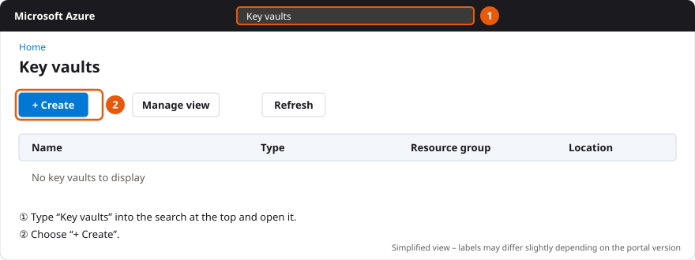
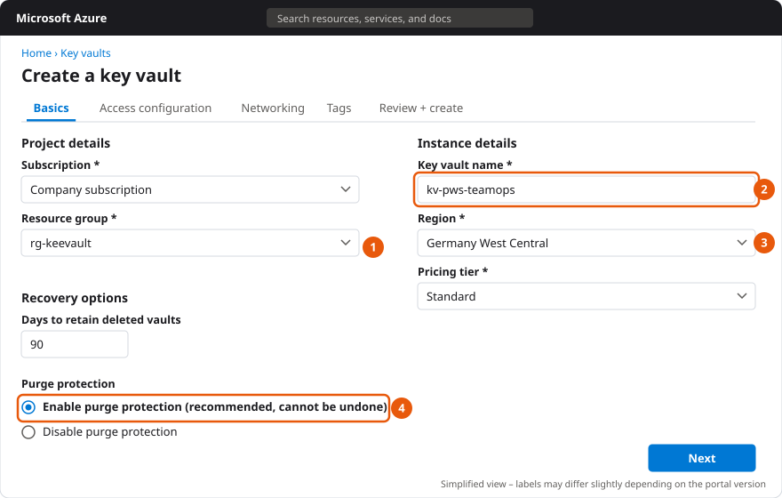
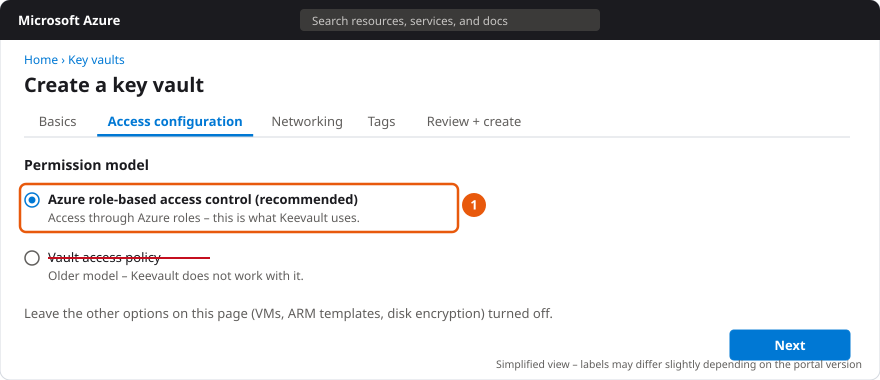
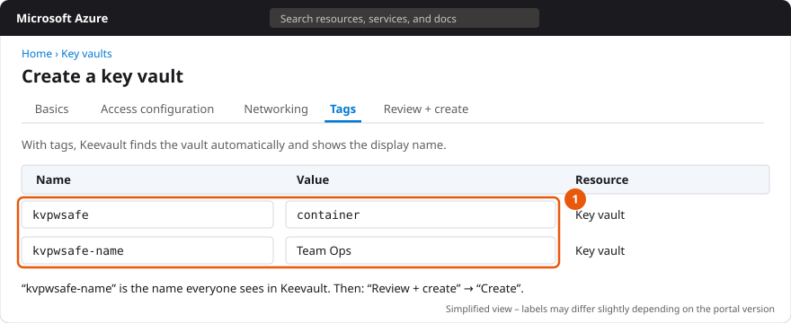
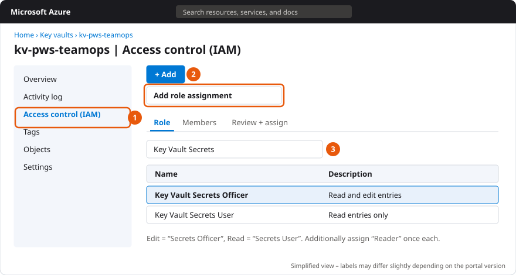
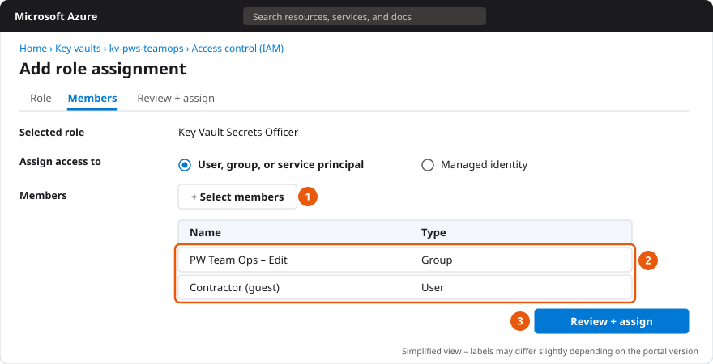
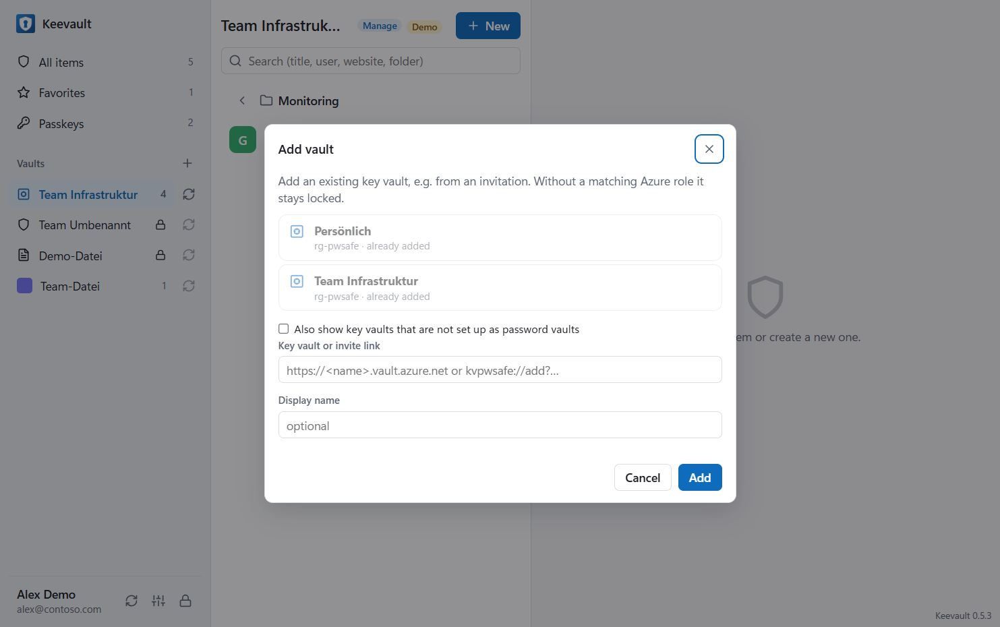

# Set up a new vault in Azure

This guide shows how to create a vault for Keevault in Azure and who needs which permissions. A vault is an Azure
Key Vault: every entry is a secret in it, access and sharing work through Azure roles. Licensing a vault is described
in a separate guide.

## Contents

1. [Before you start: what you need](#1-before-you-start-what-you-need)
2. [Option A: create the vault in the app (recommended)](#2-option-a-create-the-vault-in-the-app-recommended)
3. [Option B: create the Key Vault in Azure (one click, portal or Terraform)](#3-option-b-create-the-key-vault-in-azure-one-click-portal-or-terraform)
4. [Permissions](#4-permissions)
5. [External people and customer tenants](#5-external-people-and-customer-tenants)
6. [Network and firewall](#6-network-and-firewall)
7. [Backup, recovery and audit log](#7-backup-recovery-and-audit-log)
8. [Check and troubleshoot](#8-check-and-troubleshoot)
9. [Checklist](#9-checklist)

---

## 1. Before you start: what you need

- **An Azure subscription** and a **resource group** for the Key Vault.
- **Permissions on this resource group** to create a Key Vault and assign roles:
  - **Owner**, or
  - **Contributor** **and** **User Access Administrator**.

  Contributor alone is enough to create it, but not to give others access.
- **Keevault** (desktop app) on your computer, signed in with your work account.

> **Important for customer subscriptions:** always create the vault **in the tenant that owns the subscription** –
> with an account or guest account from that tenant. If you only see the subscription through **Azure Lighthouse**,
> no usable vault can be created there: Lighthouse assigns no roles with data access and invites no guests. More in
> [section 5](#5-external-people-and-customer-tenants).

---

## 2. Option A: create the vault in the app (recommended)

The app creates the Key Vault with the right settings, marks it as a vault and assigns the roles in one step.

1. In the sidebar, click **+** next to **Vaults** → **Create new Azure vault**.
2. Enter a **display name**, e.g. “Customer Contoso”. The app suggests a Key Vault name from it.
3. Choose **subscription** and **resource group**.
   - Subscriptions marked **(guest)** are in another tenant where you are a guest – that works.
   - Subscriptions marked **(Lighthouse only)** are blocked (see above).
   - If you lack the permissions to create resources in the resource group, the app shows this right away.
4. Under **Key vault** choose:
   - **Create a new key vault in the resource group** – then check the **Key Vault name**: 3–24 characters, letters,
     digits and hyphens, starting with a letter, **globally unique**. The name cannot be changed later (the display
     name can).
   - or **Use an existing empty key vault** (see [option B](#3-option-b-create-the-key-vault-in-azure-one-click-portal-or-terraform)).
5. Choose the **region** (e.g. “Germany West Central”) and leave **purge protection** turned on.
6. Under **Access**, enter people or – better – **Entra groups** and choose a level for each: **Read**, **Edit** or
   **Manage** (meaning see [section 4](#4-permissions)). An e-mail address that does not exist in the directory yet
   can be **invited as a guest** right away.
7. Click **Create**.

You automatically get **Edit** and **Manage**. New roles take a few minutes in Azure to take effect – if the vault
shows “No access” for a moment, click **Refresh** (arrow next to the vault name) after two or three minutes.

---

## 3. Option B: create the Key Vault in Azure (one click, portal or Terraform)

For cases where IT creates the Key Vault. All three variants lead to the same result as option A: an RBAC Key Vault
in the subscription's tenant, purge protection, tags for automatic discovery and roles for the people and groups you
want.

| Variant | For whom | Time |
| --- | --- | --- |
| [3.1 One click](#31-one-click-deploy-to-azure) | a single vault, no tools | 3 minutes |
| [3.2 Azure portal](#32-in-the-azure-portal-step-by-step) | anyone who wants to see every step | 10 minutes |
| [3.3 Terraform](#33-with-terraform) | several vaults, infrastructure as code | set up once |

Required in every case: **Owner** (or Contributor + User Access Administrator) on the resource group, signed in
**in the subscription's tenant** – at customers as a guest, not through Azure Lighthouse.

### 3.1 One click: Deploy to Azure

[](https://portal.azure.com/#create/Microsoft.Template/uri/https%3A%2F%2Fraw.githubusercontent.com%2Fdominguez-posh%2Fkeyvault-pwsafe-releases%2Fmain%2Finfra%2Fazuredeploy.json)

The button opens the template [`infra/azuredeploy.json`](https://github.com/dominguez-posh/keyvault-pwsafe-releases/blob/main/infra/azuredeploy.json)
in the Azure portal (source: [`azuredeploy.bicep`](https://github.com/dominguez-posh/keyvault-pwsafe-releases/blob/main/infra/azuredeploy.bicep)).

1. Choose **subscription** and **resource group** (or create one), **region** as you like.
2. **Vault Name**: globally unique, e.g. `kv-pws-teamops`. **Display Name**: the name in Keevault, e.g. `Team Ops`.
3. Enter the **people with access** as object IDs, as a list in square brackets, e.g. `["1a2b3c4d-…", "5e6f7a8b-…"]`:
   - **Read Principal Ids** – Read
   - **Write Principal Ids** – Edit
   - **Manage Principal Ids** – Manage (edit + share)
4. **Review + create** → **Create**.

The object ID is in **Entra ID → Users** or **Groups** → open the entry → **Object ID**. Groups instead of
individuals are easiest to maintain. You yourself automatically get **Manage** (**Grant Deployer** = `true`).

Done: the vault appears in Keevault for everyone with access after sign-in (or **Refresh**) – the template writes the
vault marker right away. Roles take up to 10 minutes in Azure.

> **Don't apply the template a second time to the same Key Vault** – or set **Write Marker** to `false` when you do.
> Otherwise it overwrites the vault marker in which Keevault stores the license and the logo.

### 3.2 In the Azure portal, step by step

**Step 1 – create the Key Vault.** In the [Azure portal](https://portal.azure.com), search for **Key vaults** at the
top and choose **+ Create**.



**Step 2 – Basics.** ① resource group, ② globally unique name, ③ region (e.g. Germany West Central), pricing tier
**Standard**, 90 days retention and ④ **Enable purge protection** (recommended, cannot be undone).



**Step 3 – Access configuration.** Permission model **Azure role-based access control**. Keevault does not work with
“Vault access policy”.



**Step 4 – Networking.** **Public access: all networks** – or selected networks, see
[section 6](#6-network-and-firewall).

**Step 5 – Tags.** `kvpwsafe` = `container` and `kvpwsafe-name` = display name. This lets Keevault find the vault by
itself. Then **Review + create** → **Create**.



**Step 6 – assign roles.** In the new Key Vault ① **Access control (IAM)** → ② **+ Add** → **Add role assignment** →
③ search for the role:

| Level | Roles |
| --- | --- |
| Read | Key Vault Secrets User **and** Reader |
| Edit | Key Vault Secrets Officer **and** Reader |
| Manage | Key Vault Secrets Officer, Key Vault Data Access Administrator **and** Reader |



On the **Members** tab ① **+ Select members**, ② choose groups or people (guests too) and ③ **Review + assign**.
Repeat once per role. Whoever sets up the vault in Keevault needs at least **Edit**.



**Step 7 – take it over in Keevault**, see [3.4](#34-take-it-over-in-keevault-portal-only).

> **Watch the Key Vault's tenant:** if the vault is created through Azure Lighthouse or from another tenant, Azure
> often enters the *wrong* tenant into the vault. Then the roles never apply. The app detects this and offers
> **Fix the key vault’s tenant**. The one-click template and Terraform always set the tenant correctly.

### 3.3 With Terraform

The code is in [`infra/terraform`](https://github.com/dominguez-posh/keyvault-pwsafe-releases/tree/main/infra/terraform).
You enter the people with access directly by name – Terraform looks them up in Entra ID:

```hcl
subscription_id       = "<subscription ID>"
tenant_id             = "<tenant of THIS subscription>"
resource_group_name   = "rg-keevault"
create_resource_group = true
vault_name            = "kv-pws-teamops"
display_name          = "Team Ops"

access = {
  read   = { groups = ["PW Team Ops – Read"] }
  write  = { groups = ["PW Team Ops – Edit"], users = ["kim.muster@contoso.com"] }
  manage = { users = ["alex.admin@contoso.com"], guests = ["contractor@partner.com"] }
}
```

```powershell
cd infra/terraform
copy terraform.tfvars.example terraform.tfvars   # adjust
az login --tenant <tenant of the subscription>
terraform init
terraform plan
terraform apply
```

- `users` = users by sign-in name (UPN), `guests` = guest users by e-mail, `groups` = security groups by display name,
  `object_ids` = further object IDs. Whoever runs `terraform apply` gets **Manage** (`grant_current_user`).
- Terraform checks that `tenant_id` is the subscription's tenant – so the Lighthouse mistake cannot happen.
- The vault marker is written once and never overwritten afterwards; license and logo are kept.
- Optional: `allowed_ip_ranges` (firewall) and `log_analytics_workspace_id` (audit log).
- As a **guest** you are often not allowed to look up users in a foreign directory. Then use `object_ids` instead of
  `users`/`groups`.

### 3.4 Take it over in Keevault (portal only)

After one click and Terraform, the vault appears by itself. With the portal, take it over once:

1. In the sidebar, click **+** next to **Vaults** → **Create new Azure vault**.
2. Choose subscription and resource group; under **Key vault** → **Use an existing empty key vault**.
3. Choose the Key Vault from the list. Only **empty** Key Vaults you have data access to can be selected.
4. Enter display name and access as in option A → **Create**.

The app writes the vault marker (secret `pws-container`) into the Key Vault. Only then does it appear for other people
under **Add vault**:



---

## 4. Permissions

### 4.1 The levels in the app and their Azure roles

All roles are assigned **on the Key Vault** (scope “this resource”) – not on the subscription.

| Level in the app | Azure roles on the Key Vault | What the person can do |
| --- | --- | --- |
| **Read** | Key Vault Secrets User | view, copy, autofill, auto-type entries |
| **Edit** | Key Vault Secrets Officer | additionally create, change, delete, restore |
| **Manage** | Key Vault Secrets Officer + Key Vault Data Access Administrator | additionally share with other people |
| *(automatic discovery)* | additionally **Reader** | the vault appears in the app's selection |

- **Owner, Contributor or Reader alone give no access to entries** – these are management roles, not data roles. Even
  an owner of the subscription sees no entries without one of the Key Vault roles above.
- Whoever only has **Read** cannot change anything with other tools (portal, CLI) either – Azure enforces this.
- Permissions always apply to the **whole vault**. Different permissions for different areas → **a separate vault**
  per area (e.g. “Team Network” and “Management”). Folders are for order only, not for permissions.

### 4.2 Recommendation: Entra groups

Assign roles to **Entra security groups** instead of individual people, e.g.:

| Group | Level |
| --- | --- |
| `Keevault-Contoso-Read` | Read |
| `Keevault-Contoso-Edit` | Edit |
| `Keevault-Contoso-Admins` | Manage |

New staff then only join the group; the vault doesn't need to be touched.

### 4.3 Assign roles in the app

Right-click the vault → **Share** → search for a person, group or e-mail → choose the level → **Share**. You need
**Manage** yourself for this (or Owner / User Access Administrator on the Key Vault).

### 4.4 Assign roles in the Azure portal

1. Open the Key Vault → **Access control (IAM)** → **Add** → **Add role assignment**.
2. Search for the role, e.g. **Key Vault Secrets Officer** → **Next**.
3. **Select members** → group or person → **Review + assign**.
4. For automatic discovery in the app, additionally assign the role **Reader**.

With the Azure CLI (example: Edit for a group):

```powershell
$vault = az keyvault show --name kv-contoso-pws --query id -o tsv
$group = az ad group show --group "Keevault-Contoso-Edit" --query id -o tsv
az role assignment create --assignee-object-id $group --assignee-principal-type Group --role "Key Vault Secrets Officer" --scope $vault
az role assignment create --assignee-object-id $group --assignee-principal-type Group --role "Reader" --scope $vault
```

---

## 5. External people and customer tenants

### Guests (Entra B2B)

External people – or you yourself at a customer – need a **guest account** in the Key Vault's tenant:

- In the app, when creating or under **Share**: enter the e-mail address → **invite as guest**. The person gets the
  invitation e-mail from Microsoft and the chosen level right away. Your account must be allowed to invite guests in
  this tenant.
- Or in the [Entra admin center](https://entra.microsoft.com) → **Users** → **Invite external user**, then share in
  the app.
- For many people: **cross-tenant synchronization** creates the guest accounts automatically.

Nothing changes in the app – it detects the tenant of every vault by itself and signs in there with the guest account.
If the foreign tenant requires its own sign-in (e.g. MFA), the vault shows **Sign in to the key vault’s tenant**.

### Azure Lighthouse is not enough

Lighthouse grants management permissions but **no data roles** on Key Vaults and invites no guests. Whoever only sees
the customer through Lighthouse additionally needs a guest account in the customer tenant with one of the roles from
[section 4](#4-permissions). That's why you should always create vaults at customers with the guest account, not
through Lighthouse.

---

## 6. Network and firewall

The app accesses the Key Vault **directly from the users' computers** (there is no server in between).

- **Public access enabled:** works everywhere; protected by Entra sign-in and roles.
- **Selected networks / firewall:** allow the public IP addresses of your sites or VPN, otherwise the app reports
  “Access blocked by the key vault firewall”.
- **Private endpoint:** reachable only from the company network or via VPN, including private DNS resolution of
  `<name>.vault.azure.net`.

---

## 7. Backup, recovery and audit log

Entries deliberately **cannot be exported** in plain text from the app. Backup works through the Key Vault – or as an
encrypted backup by owners of the subscription:

- **Soft delete (90 days):** deleted entries are in the vault's **trash** and can be restored. Every entry also has a
  **history** with all previous versions.
- **Purge protection:** even admins cannot permanently remove deleted entries or the Key Vault within the retention
  period.
- **Whole Key Vault deleted?** Restore it in the portal under **Key vaults → Manage deleted vaults**.
- **Audit log:** for an audit log (who read or changed which entry when), send the category **AuditEvent** to a Log
  Analytics workspace in the Key Vault's **Diagnostic settings**.
- **Encrypted backup:** right-click the vault → **Create backup (owner)**, see [Backup and restore](https://keevault.de/en/knowledge/backup.html).
- **Extra protection (optional):** right-click the vault → **Add protection (master password/passkey)** additionally
  encrypts all entries – then even Azure admins with a data role only see encrypted values.

---

## 8. Check and troubleshoot

After the setup:

1. Choose the vault in the app – your level (**Read**, **Edit**, **Manage**) is shown next to the name.
2. Create a test entry, open it again, delete it.
3. Ask a second person to choose the vault via **+ → Add existing key vault**.

| Message in the app | Cause | Solution |
| --- | --- | --- |
| **No access** / “No permission for this vault” | data role missing (only Owner/Contributor/Reader) or just assigned | assign a role from [section 4](#4-permissions), wait a few minutes, **Refresh**. With management permissions the app offers **Grant myself access**. |
| “Cause found: the key vault is set to the tenant …” / AKV10032 | the Key Vault trusts a different tenant than its subscription's (usually created through Lighthouse) | **Fix the key vault’s tenant** in the app, or create it again in the right tenant |
| “This key vault uses access policies instead of Azure RBAC” | wrong permission model | switch to **Azure RBAC** in the portal under **Access configuration** |
| **Sign in to the key vault’s tenant** | the customer tenant requires its own sign-in (MFA) | click the button and sign in |
| “Your account does not exist in the tenant …” | no guest account in the Key Vault's tenant (e.g. Lighthouse only) | have yourself invited as a guest ([section 5](#5-external-people-and-customer-tenants)) |
| “Access blocked by the key vault firewall” | the firewall does not let the computer through | allow the IP or use VPN ([section 6](#6-network-and-firewall)) |
| the vault does not appear in the selection | role **Reader** missing or vault not marked yet | assign Reader; it is marked the first time someone with Edit opens it. Alternatively tick “Also show key vaults that are not set up as password vaults” |

The **technical details** below an error message show the Key Vault's answer, the tenant and the account the app used
– this helps support.

---

## 9. Checklist

- [ ] The subscription belongs to the tenant you are signed in to (as a guest if need be) – not only visible through Lighthouse
- [ ] Permissions on the resource group: Owner or Contributor + User Access Administrator
- [ ] Key Vault: pricing tier Standard, **Azure RBAC**, soft delete 90 days, purge protection on
- [ ] Network: public access or your IPs / VPN allowed
- [ ] Roles on the Key Vault for Entra groups: Secrets User / Secrets Officer / + Data Access Administrator, plus Reader
- [ ] Vault created or taken over in the app (marker `pws-container` present)
- [ ] Test entry created, a second person sees the vault
- [ ] Optional: AuditEvent log to Log Analytics, extra protection, logo (right-click → Vault logo)
